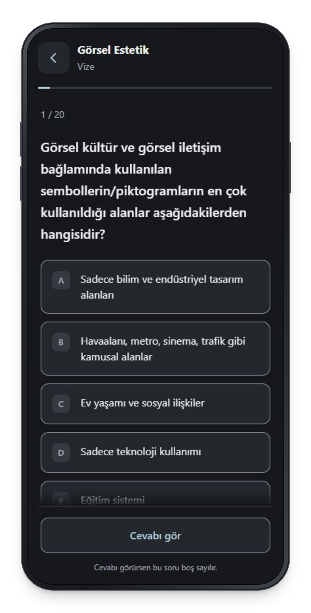

<h1 align="center">Çalışmaç</h1>

<p align="center">A simple place to practice for your next exam.</p>

<p align="center">
  
</p>

## Make it yours

Start with a Google spreadsheet containing a course catalog and separate question tabs for each course’s midterm and final. Publish it through **File → Share → Publish to web**, making sure all those tabs are included.

Copy [`.env.example`](.env.example) to `.env.local`, then fill in your spreadsheet details:

```dotenv
VITE_SHEETS_PUBLISHED_URL=https://docs.google.com/spreadsheets/d/e/YOUR_PUBLISHED_ID/pub
VITE_SHEETS_CATALOG_GID=0
```

The first value is the link you get when publishing the spreadsheet. The second is your catalog tab’s `gid`, which you’ll find in the tab’s URL.

<details>
<summary><strong>How to arrange your spreadsheet</strong></summary>

Use the column names and order below. You can import each CSV example into its own Google Sheets tab and replace the sample rows with your content.

**Course catalog**

```csv
department_id,department,course_id,course,midterm_gid,final_gid
design,Design,aesthetics,Aesthetics,11,22
```

Give departments and courses IDs using lowercase English letters, digits, and hyphens between words. Replace `11` and `22` with the `gid` values of that course’s midterm and final question tabs in the same spreadsheet.

**Question tabs**

```csv
id,question,image_url,option_a,option_b,option_c,option_d,option_e,answer
question-1,What is the capital of Turkey?,,Ankara,Istanbul,Izmir,Bursa,Antalya,A
```

Each question needs a unique `id` within its tab, five options, and the correct answer’s letter (`A`–`E`). You can leave `image_url` empty or provide an HTTPS image link. All other fields are required.

Publishing makes this content accessible to anyone with the link.

</details>

## Run locally

You’ll need **Node.js 22.18 or later**. Once your `.env.local` is ready, run these commands from the project folder:

```bash
npm install
npm run dev
```

The app opens in your browser. If you change `.env.local`, restart the development server to pick up the new settings.

<details>
<summary><strong>Publish with GitHub Pages</strong></summary>

In your repository’s **Settings → Pages**, choose **GitHub Actions** as the source.

Then open **Settings → Secrets and variables → Actions → Variables** and add these **Repository variables**, using the same values as your `.env.local`:

- `VITE_SHEETS_PUBLISHED_URL`
- `VITE_SHEETS_CATALOG_GID`

Push to `main` and the included workflow will test, build, and publish the app. If you change either variable later, run **Actions → Deploy Pages → Run workflow** to rebuild with the new values.

</details>
